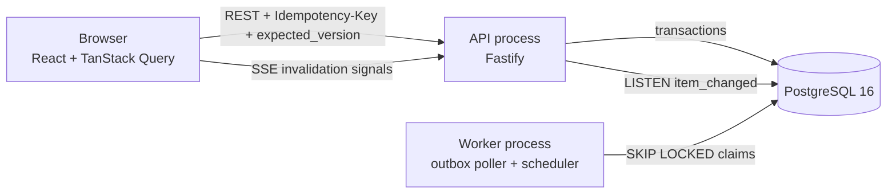

# Architecture

## Components


## Claim race (two users, same item)
```mermaid
sequenceDiagram
  participant A as User A
  participant B as User B
  participant API
  participant DB as PostgreSQL
  A->>API: POST /items/:id/claim (key a)
  B->>API: POST /items/:id/claim (key b)
  API->>DB: BEGIN; SELECT ... FOR UPDATE (A gets lock)
  API->>DB: (B waits on the row lock)
  API->>DB: UPDATE assignee=A, version+1; INSERT event claimed; INSERT outbox; pg_notify; COMMIT
  API-->>A: 200 item(assignee=A)
  API->>DB: (B proceeds) item already assigned -> ROLLBACK
  API-->>B: 409 already_claimed {assignee: A}
```

## Async flow
Mutation transaction writes `item_events` + `outbox` rows → commit → worker claims outbox rows (`SKIP LOCKED`) → handler inserts `notifications` (idempotent) → row `done`; failures retry with backoff, then `dead`.

## Data model summary
`users` ─< `team_memberships` >─ `teams` ─< `work_items` ─< `item_events` (append-only), `comments`, `approvals`, `item_watchers`; `notifications` (per user/event); `outbox` (per event/handler); `idempotency_keys` (per user/key).

## Request pipeline
validate (zod) → authenticate (JWT + DB actor) → idempotency (in tx) → lock item → visibility (404) → expected_version (409) → permission/guards (403/409) → update + event + outbox + notify → store response → commit.
